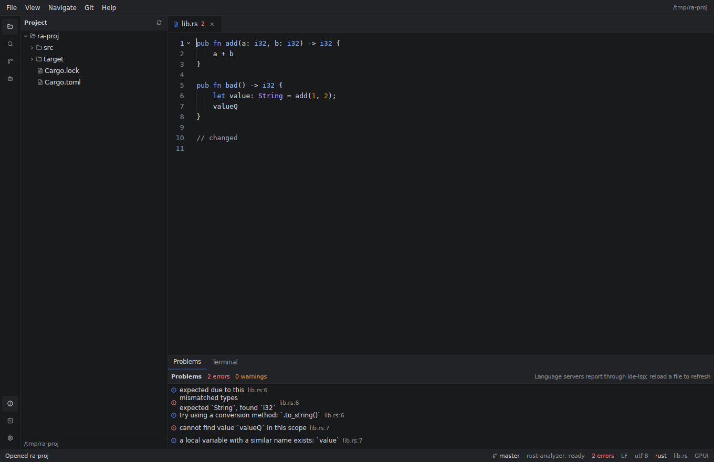
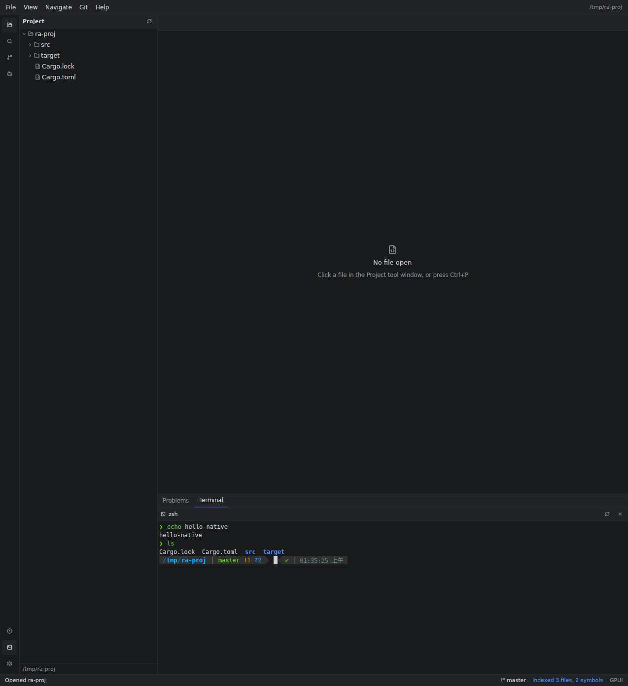

# Replacing Tauri with the GPUI ecosystem

This document tracks the migration of OpenIDEA's desktop shell from
Tauri v2 + React/CodeMirror to a native Rust UI built on **gpui-kit**
(GPUI + `gpui-base` + `gpui-component`).

The backend never needed the webview: every feature already lives in the
`ide-*` crates and is reached through `ide-host::Host`. The Tauri layer was a
thin adapter (`src-tauri/src/commands/*.rs`, ~4.3k lines) between that facade
and a 267k-line TypeScript UI. This migration deletes the adapter and the
TypeScript UI, and draws the IDE with GPUI instead.





## What exists now

Two crates are added; the Tauri app is untouched and still builds:

| Crate                | Role                                                                                       |
| -------------------- | ------------------------------------------------------------------------------------------ |
| `crates/ide-ui`      | OpenIDEA's native workbench: theme, project tree, editor area, menu bar, palette, status bar |
| `crates/openidea-gpui` | The `openidea-gpui` binary: boot, dirs, logging, `Host`, event bridge, window              |

```sh
cargo run -p openidea-gpui                 # empty workbench + welcome screen
cargo run -p openidea-gpui -- path/to/dir  # open a project
cargo run -p openidea-gpui -- path/to/file # open the file's project and the file
```

`pnpm dev:gpui` and `pnpm build:gpui` wrap the same commands.

### Verified end-to-end (this machine, Linux/Wayland + Xwayland, stable 1.95)

- Window opens with the OpenIDEA palette (Islands Dark / Light, taken from
  `src/styles/tokens.css`), menu bar, tool-window stripe, project tree, editor
  area and status bar.
- Opening `/home/wxy/openidea` indexes 3211 files / 48647 symbols in ~1.4 s
  through `ide-host::Host` — the same code path the Tauri app used, with no IPC
  and no serialization.
- rust-analyzer initializes from the native editor (`didOpen` through
  `Documents`), publishes diagnostics that appear in the Problems panel and
  editor, and answers completion requests (218 items on a sample position),
  hovers and definitions through `IdeLspProvider`.
- Trust flow: an untrusted project shows Restricted Mode; clicking **Trust
  Project** persists the decision and starts the server in the same session.
- Terminal: typing `echo hi-native > /tmp/term-check.txt` in the native grid
  created the file with the expected content, and command output rendered with
  the ANSI palette. Auto-resize: `stty size` reported 18×117 at 12 px,
  16×101 at 15 px and 15×95 at 16 px (Settings › Terminal font). Tabs: **+**
  spawned a second shell (`echo tab2` wrote its file), switching back ran
  `echo tab1`, and closing the second tab terminated its shell.
- Git: **Stage All** + **Commit** from the native panel created the commit
  `native commit` in the sample repository (`git log -1`); the Diff tab
  rendered the added block with tinted rows and hunk headers.
- Debug console REPL: entering `x * 2` sent `evaluate: x * 2` to the adapter.
- Logpoints: `line5 x={x}` stored as `"logMessage"` through the dialog
  (alongside the condition flow below).
- Breakpoints: a condition `x > 0` was set through the dialog and stored in
  `breakpoints.json`; the On/Off toggle flipped `enabled` and removed/added the
  editor tint; both survived a restart. `Ctrl+F8` persisted `<config>/breakpoints.json`, survived a
  restart and repainted the line (composited `#493740` fill on One Dark);
  **View Breakpoints…** opened from the Debug menu, and the backend
  `set_breakpoints` path stored them. Watches: typing `x` in the Debug panel
  sent `evaluate x` to the adapter (verified in the adapter log).
- Debug: a fake stdio DAP adapter (registered through a temporary user language
  definition) exercised the full loop — `Started` → `Initialized` → `Stopped`,
  call stack `main`/`run`, variables `x = 42` and `greeting = "hello-dap"`,
  **Resume** produced `Continued` → `Terminated`, and **Step Over** produced
  `Continued` → `Stopped(reason = step)`. A real CodeLLDB/js-debug adapter is
  not installed on this machine, so missing-adapter errors were verified too.
- Run: `F5` on the sample project started the detected `npm run hello`
  configuration, its stdout (`finished`) appeared in the console, the backend
  reported `Process finished with exit code 0`, and **Shift+F5** stopped a
  `sleep 20` run (the npm process disappeared).
- HTTP: `GET http://127.0.0.1:8765/hello.txt` sent from the panel reached a local
  `python3 -m http.server` (access log `"GET /hello.txt HTTP/1.1" 200`), and the
  panel rendered the green `200 OK` status and the two body lines.
- Editor integration: launching with `requests.http` open and pressing `Alt+7`
  showed the `One`/`Two` block chips and the `dev` env; `Ctrl+Alt+R` at the
  first request fetched `/one.txt`, and with the caret on the second block it
  fetched `/two.txt` with `{{host}}` resolved.
- `.http` files: loading a file with two blocks produced `Hello` / `Env request`
  chips and a `dev` environment; `GET http://{{host}}/env.txt` resolved to
  `127.0.0.1:8766` and the server logged `"GET /env.txt HTTP/1.1" 200`; switching
  to the `Hello` block fetched `/hello.txt`, and both exchanges appeared in the
  history (status 200).
- Database: a SQLite data source produced by `.openidea/data-sources.toml`
  connected through the panel; `INSERT INTO items…` typed in the console added
  a row (verified with the `sqlite3` CLI) and `SELECT * FROM items` rendered
  three result rows plus the `items` table chip. With a 250-row table, opening
  it loaded page 0 (100 rows), **Next** moved to offsets 100 and 200 (50 rows),
  and clicking the `id` header reloaded sorted ascending, then descending.
  Row editing: renaming `beta` to `beta2` and saving updated the row in SQLite;
  deleting that row removed it from the table; + Row with just `name`/`qty`
  filled inserted `4|delta|4` (autoincrement id). The sidebar showed
  `SCHEMAS / main` and `TABLES`; clicking the table row loaded its page
  (2 rows for `logs`) and highlighted the row; expanding `items` fetched and
  rendered its 3 columns between the two table rows, and re-clicking collapsed.
  On a table with two indexes, expansion also rendered the INDEXES section
  (`idx_items_code UNQ`, `idx_items_name`) and the DDL chip loaded 163 bytes of
  CREATE statements into the modal, which closed from its Close button.
  On a `child → parent` schema with two triggers, expanding `child` rendered
  FOREIGN KEYS (`parent_id → parent.id`) and TRIGGERS (`trg_child_ai`,
  `trg_child_au`); the refresh button reloaded the table list and allowed
  expanding again. CSV export of a page containing `he said "hi", ok` and a
  multi-line value produced correctly quoted rows in
  `.openidea/exports/items-…csv`.
- Go to Line: `Ctrl+G` → `3` → Enter placed the caret at the start of line 3;
  typed `//GOTO ` and `Ctrl+S` saved it into that line. View › Zoom In wrote
  `editor.fontSize = 14.0`, Reset Zoom wrote `13.0`.
- Find in File: `Ctrl+F` → `beta` → Enter jumped to the match on line 2; typed
  `XX` and `Ctrl+S`, the file line became `fn XXbeta() {}` (the bar's
  next-frame focus and the editor hand-off were verified through tracing).
- Find highlights: searching `alpha` in a 4-line file tinted 1678 pixels
  (four matches); Esc cleared them to 3 residual pixels.
- Agents: the panel listed the built-in providers with OpenCode marked
  installed; picking OpenCode and pressing Enter created a task through
  `ops::agent::create` (`status: Starting`) and the subscription streamed
  task/entry events into the panel; a second task run showed the task list and
  conversation rendering (opencode itself exited without auth, surfaced as the
  task status/error).
- Terminal split: the split button spawned a second shell and rendered two
  panes with their own prompts; clicking the left pane routed keys to
  `TerminalId(2)` (keys log target 1) and the right pane to `TerminalId(1)`
  (target 0), and a typed `pwd > /tmp/tp4.txt` executed in the shell.
- Notebook: a 3-cell `sample.ipynb` opened with `Alt+8`; the panel rendered
  the markdown cell, two code cells (`CODE [2]`, `CODE`), their sources and
  outputs (`hello from notebook`, `42`) with the notebook tab active.
- Recent Projects modal: seeded `recent.json` with `ra-proj` (active) and
  `ra-proj2`, File › Open Recent Project… rendered both rows with the active
  one highlighted; clicking `ra-proj2` opened it (`opened /tmp/ra-proj2 in
  window main`, 15 indexed files) and the title became `OpenIDEA — ra-proj2`.
- Layout: dragging the left splitter 280 → 358 px moved the panel border to
  x = 398, Problems 180 → 241 and Terminal 366 → 426 px were persisted; the
  terminal reported `stty size` 18×109 before and 21×109 after the drag, and
  the widths/heights came back after a restart.
- Settings: the editor font stepper wrote `editor.fontSize = 17` and the
  terminal stepper `terminal.fontSize = 14` to `settings.toml`; the editor's
  line spacing grew from 22 to 26 px and both sizes were reapplied after a
  restart. Card clicks stay inside the dialog (modals are occluded from their
  backdrop).
- Appearance: switched to **One Dark** in the dialog (window background became
  `#282c34`), `ui.json` recorded `"one-dark"`, and a restart opened directly in
  that theme.
- Find in Path returns real hits from `ide-search` and opens them at the line;
  Go to File opens files from the index; the Git panel lists repository status
  (17 changed files on the sample repo) and the status bar shows the branch.
- Project tree: lazy `read_dir` per expansion (`ide-vfs`, `.gitignore`-aware,
  ignored entries dimmed), folder click expands/collapses, file click opens.
- Editor: `gpui-component`'s `EditorState` over **the project's shared
  `Documents` buffers**: opening a file registers it with the language
  servers, every keystroke is forwarded as an incremental `didChange`, saving
  goes through `Documents::save`, and `DocPatched` (formatters, refactors,
  LSP workspace edits) is applied back to the visible buffer. Encoding, BOM,
  line endings and `.editorconfig` come from `ide-workspace`. Tabs, dirty dot,
  clickable error counts, `Ctrl+S` / `Ctrl+Shift+S` / `Ctrl+W` / `Ctrl+Tab`.
- Language servers: rust-analyzer (and any configured server) starts on the
  first `didOpen`, its status is shown in the status bar, and a project in
  Restricted Mode gets a banner with a working **Trust Project** action that
  records the decision and enables servers/hooks without a restart.
  Diagnostics land in the editor gutter, the tab counts, the status bar and
  the **Problems** tool window (click jumps to file/line).
- LSP providers for the editor element: completion, hover and go-to-definition
  call `ide-lsp` directly (`IdeLspProvider`), and `showDocument` opens the
  target file at the definition.
- **Project opening**: CLI path (dir/file), `Ctrl+O` folder picker, drag-drop,
  and **File › Open Recent Project…** — a modal over `recent.json` showing the
  active project highlighted plus git branch, with a Browse… fallback; picking
  a row switches the whole workbench (tree, editor, LSP, tools) in place.
- **Go to File** (`Ctrl+P`): fuzzy `ProjectIndex::find_files`, recent files
  first, keyboard navigation and Enter to open.
- **Go to Line** (`Ctrl+G`, Navigate menu): modal input accepting `line` or
  `line:column` (1-based), jumps the active editor caret and focuses it.
- **Find in File** (`Ctrl+F`, Navigate menu): floating bar over the editor with
  live match count, case-insensitive search over the active tab, every match
  highlighted with a warning fill (RangeDecoration), Enter/next, prev and close
  (Esc or ×, which also clears the highlights); jumps focus the editor so typing
  continues at the match.
- **Zoom**: View › Zoom In / Zoom Out / Reset Zoom change the editor font size
  in 1 px steps and persist it to `settings.toml` (`editor.fontSize`).
- **Find in Path** (`Ctrl+Shift+F`): streams `ide-search` results from a worker
  thread, grouped by file, click opens at the matching line.
- **Git** tool window: changed files of every repository (`ide-vcs`), status
  letters/colours, refresh on `VcsChanged`, branch in the status bar, and
  *Stage All* / *Commit* controls backed by `Repo::stage` / `Repo::commit`.
- **Terminal**: `ide-terminal` PTY + a native VT grid (`vt100`): zsh prompt,
  split panes (the split button starts a second shell and renders both VT grids
  side by side at half width; clicking a pane routes keys to that session),
  ANSI colours, block cursor, arrow/control keys, scrollback, restart/kill.
  No xterm.js and no webview. Multiple tabs each own a PTY; the grid is
  derived from the window width and the font size (columns × rows are pushed
  to the PTY, so `stty size` follows resizes and Settings › Terminal font
  changes).
- **Diff viewer**: Git rows have a *Diff* action; the bottom `Diff` tab shows a
  unified diff against `HEAD` with line numbers, `±` gutters, hunk headers and
  three lines of context (old side from `Repo::file_bytes_at`, new side from
  the open document or disk).
- **Run tool window** (`run`): detected `package.json` / Cargo / Gradle / Maven
  / Go / pytest / Make configurations plus `.openidea/run.toml`, a config
  switcher, **Run** (`F5`) and **Stop** (`Shift+F5`) through the host's
  `ProcessManager`, a streaming console with stdout/stderr/system colours,
  clearing, exit codes and automatic scrollback.
- **Debug tool window** (`debug`): starts DAP sessions through the shared
  `ide_host::ops::debug::debug_start` path (trust checks, adapter resolution),
  follows `IdeEvent::Debug` for the session, and shows the call stack,
  frame-scoped variables and adapter output. Resume (`F9`), pause, step
  over/into/out (`F8`/`F7`/`Shift+F8`) and stop (`Ctrl+F2`) run on the host
  runtime; frames are clickable and reload their scopes. `Shift+F9` starts
  debugging the selected run configuration, `Alt+5` focuses the tool window.
  Breakpoints: `Ctrl+F8` toggles one on the caret line, the line is highlighted
  in the editor, **View Breakpoints…** (`Ctrl+Shift+F8`) lists/jumps/removes
  them, toggles them on/off and edits a **condition** or a **log message**
  (logpoint; Enter applies, empty clears). Entries are persisted per project in `<config>/breakpoints.json` and
  mirrored through `DebugManager::set_breakpoints` with condition, enabled and
  log-message fields (sent on session start).
  Watches evaluate the expression against the selected frame on Enter and
  refresh on every stop; the console has an **Evaluate** input that prints the
  result of an expression for the current frame (`debugger.evaluate`).
  Not ported yet: breakpoint dots in the editor gutter, conditions/logpoints,
  a REPL/evaluate window, and the Cargo/Gradle/Java launch builders.
- **Appearance**: all seven built-in palettes (Islands Dark/Light, High
  Contrast, Solarized Dark/Light, One Dark/Light) ported from `tokens.css`,
  with an Appearance dialog and the choice persisted to
  `<config>/ui.json`; `Toggle Theme` switches to the family's counterpart.
- **Database tool window** (`Alt+3`): data sources from
  `.openidea/data-sources.toml` (SQLite, PostgreSQL, MySQL, SQL Server), a SQL
  input that runs on Enter through `Project::db` (`DbManager::pool` +
  `execute`, 300-row limit), a results grid with column types, `NULL` values,
  affected-row/elapsed summaries, and a table strip that fills
  `SELECT * FROM "table" LIMIT 100` (populated after a successful connect).
- **Notebook** (`Alt+8`, View menu): read-only native viewer over
  `Project.notebooks` (`ide-notebook`): markdown and code cells with sources,
  execution counts, stream/result/error outputs, dirty state and nbformat in
  a bottom tool window; opened from the active `.ipynb` tab. Editing and
  kernel execution still require the Tauri shell (no `ipykernel` here).
- **Agents** (`Alt+9`, View menu, Bot in the tool stripe): provider list from
  `ops::agent::providers` (installed dot, PATH status), persisted tasks with
  their status, a streamed conversation (user/agent/thought/tool/plan/message/
  permission/error entries) from `ops::agent::subscribe`, task creation through
  `ops::agent::create` (local checkout) and prompt/cancel controls. The MVP
  renders and drives the ACP task lifecycle; permissions, worktree isolation,
  agent settings and registry installs stay with the Tauri shell for now.
- **HTTP Client** (`Alt+7`): method/URL/header/body fields assembled into the
  `.http` text format and sent through `ide_http::run` (proxies and variables
  included), with a status line (colour by class, protocol, ms, size), response
  headers and a scrollable monospace body. Press Enter in any field to send.
  The **File** row loads a `.http` file: request blocks become chips, the
  `http-client(.private).env.json` environments become an ENV selector
  (`{{variables}}` are resolved), and the last five exchanges are kept as a
  clickable HISTORY strip (newest first, saved to the project history).
  Opening a `.http`/`.rest` file in the editor and pressing `Alt+7` loads it
  automatically; **Ctrl+Alt+R** runs the request block under the caret (a single
  environment is selected automatically).
- **Resizable workbench**: drag the 4 px splitter right of the project panel or
  above the bottom tool window; left width and each bottom tab's height are
  stored in `<config>/ui.json` under `layout` and restored on launch. The
  terminal grid follows the resized viewport (`stty size` changes with a drag).
- **Settings** (`Ctrl+Alt+S`, File › Settings…): native dialog with live
  editor and terminal font-size steppers (written as `editor.fontSize` /
  `terminal.fontSize` to `<config>/settings.toml` through `SettingsStore`),
  the current theme with a shortcut to the Appearance dialog, and read-only
  tab size / indent / shell values from the effective settings.
- Command palette (`Ctrl+Shift+P`): filtered list, keyboard navigation,
  executes workbench commands; focus returns to the previous view on close.
- Menu bar (File / View / Navigate / Help) with working actions, a native
  window title, light/dark toggle, status bar with language, encoding, line
  ending and dirty state.
- Backend events (`IdeEvent`) flow from `ide-core::EventSink` through a channel
  onto the GPUI thread; notifications update the status bar. Indexing progress
  is logged today and becomes a status item in Phase 1.

## Ecosystem choices

Checked against crates.io at the time of writing:

- **`gpui` is published as `gpui-pre` 0.3.10.** `gpui-kit` 0.8.1 pins it and
  re-exports it, so the app depends on `gpui-kit` alone (`use gpui_kit::*`).
- **`gpui-kit` 0.8.1** = GPUI + `gpui-base` (behavior: docking, tabs, trees,
  input engine, theme tokens) + `gpui-component` 0.8.1 (60+ styled widgets:
  menu, palette, editor, tree, dock, status bar…) + Lucide assets.
- **`gpui-ce` 0.3.0** is a *separate community fork* of GPUI with its own type
  identity (`gpui_ce_*`). It cannot be mixed with `gpui-kit`/`gpui-component`:
  `App`, `Window`, `Element` and `Action` would be different types. We use the
  Kit stack because it is the one with the component library an IDE needs.
  If the fork ever gains a component ecosystem that matters more, switching is
  a foundation-level swap, not a widget-level one.

### Tree-sitter version conflict (important)

The repository pins `tree-sitter = 0.25` (`ide-language`, `ide-syntax`,
`ide-analysis`, 36 bundled grammars, `ast-grep-core = 0.40.1`).
`gpui-component` 0.8.1's tree-sitter highlighter requires `tree-sitter 0.26`,
and Cargo refuses two versions of a crate that declares `links = "tree-sitter"`
in one dependency graph.

For now the native editor uses `gpui-component`'s **syntect** highlighter
(`syntect` feature), which has no such conflict and already highlights the 40+
languages the app opens. The structural features that need the repo's own
tree-sitter (outline, folding, LSP fallbacks, structural search) keep using
`ide-syntax`/`ide-language` on 0.25.

**Phase 1 prerequisite to get tree-sitter highlighting in the editor:** bump
the workspace to `tree-sitter 0.26`, update the 36 grammar crates to
`tree-sitter-language 0.1`-compatible releases that build against 0.26,
bump `ast-grep-core` to 0.40.2+, run `ide-language`/`ide-syntax`/
`ide-analysis` tests, then enable `gpui-kit`'s `tree-sitter` and
`tree-sitter-languages` features and call `set_highlighter` with the same
language names the editor already passes.

## Architecture

```
                       ┌──────────────────────────────┐
   before              │  React 19 + CodeMirror (267k) │
                       │  bindings.ts (tauri-specta)   │
                       │  Tauri IPC  (4.3k adapter)    │
                       └──────────────┬───────────────┘
                                      │
                       ┌──────────────▼───────────────┐
                       │  ide-host::Host              │
                       │  projects, documents, LSP,   │
                       │  DAP, terminals, VCS, DB, …  │
                       └──────────────────────────────┘

   after               ┌──────────────────────────────┐
                       │  openidea-gpui (binary)      │
                       │  Workbench / panels (ide-ui) │
                       │  direct calls, no IPC        │
                       └──────────────┬───────────────┘
                                      │
                       ┌──────────────▼───────────────┐
                       │  ide-host::Host  (unchanged) │
                       └──────────────────────────────┘
```

Consequences:

- No `src/bindings.ts`, no `tauri-specta`, no JSON command layer. UI state that
  used to cross a process boundary is now shared Rust data.
- Backend events use the existing `EventSink` trait; `ide_ui::events::EventBridge`
  pushes them onto a `futures` channel drained by a GPUI foreground task.
- Window-scoped state (`AppState` in the old shell) becomes `Workbench`, one per
  window; `Host` stays process-wide and multi-window capable (`window` labels
  are still passed, `"main"` today).

## Parity matrix

Status of the Tauri shell's features in the native app.

| Area | Tauri (current) | GPUI (now) | Phase |
| --- | --- | --- | --- |
| Project open / recent / welcome | yes | open via CLI/picker/drop + Recent Projects modal; no welcome window | P3 (welcome) |
| Project tree (lazy, gitignore, expand) | yes | yes | — |
| Editor load/save, encoding, line endings | yes | yes | — |
| Syntax highlighting | CodeMirror/Lezer | syntect | tree-sitter in P1 |
| Tabs, dirty state, close | yes | yes | — |
| Go to File / Line | yes | Ctrl+P, Ctrl+G (line[:column]) | — |
| Find in file | yes | Ctrl+F bar, count, next/prev, highlight all, Esc | P2 (regex) |
| Editor zoom | yes | View menu, persisted `editor.fontSize` | P2 (keybindings) |
| Menu bar | native `menu.rs` (1.6k lines) | 6 menus, core actions | P2 (full menu set) |
| Command palette | yes | yes (13 commands) | grows with actions |
| Status bar | yes | language/encoding/line ending/dirty/messages | P1 |
| Light/dark + 7 palettes | yes | all 7 + Appearance dialog + persistence | — |
| LSP: diagnostics, completion, hover, goto | yes | diagnostics + providers (component popup UI) | P1 polish |
| Code insight: inspections, refactors, structure | yes | no | P2 |
| Search (find in path, replace) | yes | find in path (no replace/scope UI yet) | P1/P2 |
| VCS tool window, diff, commit | yes | changed files, diff vs HEAD, stage all, commit | P2 polish (hunks) |
| Run configurations, run tool window | yes | detect/run/stop/console + F5 | — |
| Debugger (DAP) | yes | sessions, stack, variables, watches, REPL, editable conditions/logpoints, step/stop | P1 (gutter dots, hit counts) |
| Terminal | xterm.js + `ide-terminal` | native VT grid, tabs, split panes, auto PTY resize, font size | P2 |
| Problems / notifications panels | yes | Problems with real diagnostics (notifications: status bar) | P1 |
| Database tool window | yes | sources, sidebar with columns/indexes/FKs/triggers + DDL modal + refresh, SQL console, paged grid, row edit/delete/insert, CSV export, auto-connect | P2 (inline cell edit, views) |
| Notebook | yes | read-only native viewer (cells, outputs, nbformat); Alt+8 | P2 (edit cells, kernel execution) |
| Agents | yes | providers/tasks/conversation, create local task, prompt, cancel; Alt+9 | P2 (permissions, worktrees, settings, registry) |
| HTTP client | yes | fields, `.http` files with block/env selectors, history, editor auto-load + run-at-caret | P2 (gutter run icons, response tools) |
| Notebooks, agents | yes | no | P3 |
| Plugins (WASM), remote dev, SSH/SFTP | yes | no | P3 |
| Settings windows | yes | editor/terminal font size + theme; read-only fields | P2 (full tree, keymap editor) |
| Panel resizing / layout persistence | yes | drag splitters, per-tab heights in `ui.json` | — |
| Dockable/floating tool windows, drag-to-split | yes | no | P3 |
| Multi-window / window groups | yes | no | P3 |
| Updater, single instance, window-state | yes | no | P4 |
| Playwright e2e | yes | no | P2 (`gpui_kit::test`) |

Rough size of what remains: the TypeScript UI is ~267k lines across 400 `.tsx`
files. The largest single blocks are the editor core (CodeMirror extensions,
LSP glue, diff/merge), the debugger, the database and HTTP tooling, and
settings. None of it is blocked by the backend; it is UI work.

## Phases

### Phase 0 — foundation (this change)

`ide-ui` + `openidea-gpui`, theme mapping, workbench shell, project tree,
file editor, palette, menus, event bridge, docs. Tauri remains the shipped app.

### Phase 1 — daily-driver editor (mostly landed)

1. ~~Documents-backed buffers, `DocPatched/DocDirty/Diagnostics` wiring,
   Problems panel~~ (done).
2. ~~LSP diagnostics decorations and completion/hover/definition providers~~
   (done; popup styling and inline completion are follow-ups).
3. ~~Search tool window on `ide-search`; quick open on the index~~ (done;
   replace, scopes and search options are follow-ups).
4. ~~Git tool window listing status; branch in the status bar~~ (done;
   stage/commit/diff next).
5. Upgrade tree-sitter to 0.26 and switch the editor to the tree-sitter
   highlighter (see above).
6. Docking via `gpui-base::dock::DockArea` (+ its `gpui-component` skin):
   floating/dragging tool windows, persisted layout.
7. ~~Terminal: `ide-terminal` grid rendering, keys, scrollback~~ (done, fixed
   grid; size the grid from the panel bounds next).
8. Settings read path (`ide-workspace::SettingsStore`) for fonts and keymap;
   status bar indexing indicator (partly done; theme choice persisted).

### Phase 2 — IDE parity for code work

Code insight (inspections, intentions, refactor dialogs), VCS tool window and
diff view, run configurations and run tool window, debugger UI, problems and
notifications panels, settings windows, keymap editor, e2e tests with
`gpui_kit::test`.

### Phase 3 — the long tail

Database, HTTP client, notebooks (Jupyter), agents, plugins, remote
development (ide-host already has a JSON-RPC server), SSH/SFTP, window groups.

### Phase 4 — delete Tauri

Remove `src-tauri`, `src/`, `index.html`, Vite/TypeScript/Playwright config and
the npm dependency tree; move packaging (icons, entitlements, bundle config)
to the native binary. Until then both apps build from the same workspace.

## Risks and traps

- **API churn.** GPUI is pre-1.0 and `gpui-kit` pins `gpui-pre` exactly. Treat
  `gpui-kit` as the public API (the Kit's own guidance), and upgrade it as a
  unit with visual checks.
- **Editor capability gap.** `gpui-component`'s editor is explicitly aimed at
  simple code editing (≈50k lines), not at CodeMirror parity: no multi-cursor,
  no block indent, limited IME coverage, no LSP UI yet. Phase 1 closes the LSP
  part; multi-cursor and large-file handling may need upstream work or a
  purpose-built editor element.
- **Key dispatch.** Bindings are scoped by key context (`"Workspace"`). The
  editor owns many Ctrl bindings; always check new shortcuts against
  `gpui-base`'s input map. `secondary-` must go through `KeyBinding::load` (not
  `new`) or it panics.
- **Focus.** Overlays must restore the previous focus handle when they close;
  otherwise shortcuts silently stop working (fixed for the palette).
- **Fonts.** `.SystemUIFont` may not resolve on Linux; the theme names
  `DejaVu Sans`/`DejaVu Sans Mono` there and `Segoe UI`/`Consolas` on Windows.
  Shipping Inter/JetBrains Mono as embedded assets would restore the web UI's
  typography.
- **Threading.** `Host` operations such as `open_project` are synchronous and
  currently run on the UI thread (acceptable at ~1.4 s for 3.2k files, visible
  on large projects). Move them to the tokio runtime with a progress state
  before shipping.
- **Accessibility.** GPUI's accesskit support is new; the old web UI had ARIA.
  Audit in Phase 2.
- **Native folder picker.** Open Project uses `rfd` over the XDG desktop
  portal. Machines without a portal (some minimal Wayland sessions) get
  nothing back; add an in-app path field as the fallback.
- **Toolchain.** The workspace's declared MSRV is 1.96 (wasmtime and Tauri
  need it). The GPUI crates build on 1.95; if `cargo check -p openidea` fails
  here with `requires rustc 1.96.0`, that is the pre-existing MSRV, not this
  change.

## Keeping the Tauri app working

Nothing in this change modifies `src-tauri` or `src`. The only workspace edits
are new members (`crates/ide-ui`, `crates/openidea-gpui`), a `gpui-kit`
dependency and `rfd`. The tree-sitter conflict is avoided by using syntect, so
`cargo build -p openidea` and `pnpm tauri dev` keep working.

Rule for the transition: **new UI features go native**; the Tauri shell only
receives critical bug fixes until Phase 4.
